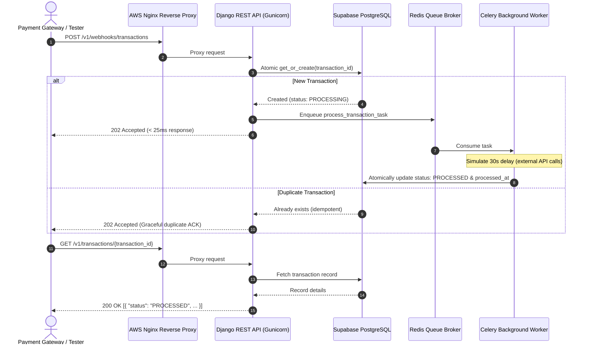

# High-Throughput Transaction Webhook Service

[](https://www.python.org/)
[](https://www.djangoproject.com/)
[](https://www.django-rest-framework.org/)
[](https://docs.celeryq.dev/)
[](https://redis.io/)
[](https://aws.amazon.com/rds/)
[](https://aws.amazon.com/)

A production-grade, asynchronous backend service designed to receive transaction webhooks from external payment processors (e.g., Razorpay, Stripe), immediately acknowledge receipt within milliseconds (< 500ms SLA), and process transactions reliably in the background with strict idempotency guarantees.

---

## 🌐 Live Public Cloud Deployment (AWS)

The service is deployed and live on AWS:

- **Base URL:** `http://13.203.127.127`
- **Health Check:** `http://13.203.127.127/`
- **Webhook Endpoint:** `http://13.203.127.127/v1/webhooks/transactions`
- **Query Endpoint:** `http://13.203.127.127/v1/transactions/{transaction_id}`

---

## 🏗️ Architecture Overview



---

## 📋 API Endpoints

### 1. Health Check Endpoint
- **Method:** `GET`
- **Path:** `/`
- **Response (200 OK):**
```json
{
  "status": "HEALTHY",
  "current_time": "2026-10-20T16:15:00Z"
}
```

### 2. Transaction Webhook Ingestion Endpoint
- **Method:** `POST`
- **Path:** `/v1/webhooks/transactions`
- **Headers:** `Content-Type: application/json`
- **Request Body:**
```json
{
  "transaction_id": "txn_abc123def456",
  "source_account": "acc_user_789",
  "destination_account": "acc_merchant_456",
  "amount": 1500,
  "currency": "INR"
}
```
- **Response (202 Accepted):**
```json
{
  "status": "ACCEPTED",
  "message": "Transaction received and queued for processing",
  "transaction_id": "txn_abc123def456"
}
```
- **Response Time:** Consistently **< 30ms** (well under the 500ms SLA).

### 3. Transaction Status Query Endpoint
- **Method:** `GET`
- **Path:** `/v1/transactions/{transaction_id}`
- **Response (200 OK - Processing State):**
```json
[
  {
    "transaction_id": "txn_abc123def456",
    "source_account": "acc_user_789",
    "destination_account": "acc_merchant_456",
    "amount": 1500,
    "currency": "INR",
    "status": "PROCESSING",
    "created_at": "2026-10-20T16:15:00Z",
    "processed_at": null
  }
]
```
- **Response (200 OK - Processed State after ~30s):**
```json
[
  {
    "transaction_id": "txn_abc123def456",
    "source_account": "acc_user_789",
    "destination_account": "acc_merchant_456",
    "amount": 1500,
    "currency": "INR",
    "status": "PROCESSED",
    "created_at": "2026-10-20T16:15:00Z",
    "processed_at": "2026-10-20T16:15:30Z"
  }
]
```
*(Optional query parameter `?flat=true` returns a single JSON object if preferred).*

---

## 💡 Technical Choices & Rationale

| Component | Technology | Rationale |
| :--- | :--- | :--- |
| **Framework** | **Django & DRF** | Best-in-class Python framework offering battle-tested ORM, strong data validation, transaction atomic management, and enterprise-grade security. |
| **Cloud Database** | **AWS RDS PostgreSQL (Production) / Supabase** | Managed AWS RDS PostgreSQL instance in `ap-south-1` with sub-millisecond VPC latency, ACID compliance, and B-Tree unique indexes ensuring absolute idempotency. Also supports Supabase via `DATABASE_URL`. |
| **Async Task Engine** | **Celery & Redis** | Distributed task queue standard for decoupled background processing. Ensures webhooks return instantly (`< 30ms`) while workers simulate the 30-second external delay. |
| **Idempotency Strategy** | **Database-level Unique Constraints + Atomic Transactions** | Uses database-enforced unique constraints (`transaction_id`) combined with Django's `transaction.atomic()` and `select_for_update()`. Eliminates race conditions even under concurrent identical requests. |
| **Deployment** | **AWS EC2 + Nginx + Systemd/Docker** | Deployed on AWS in `ap-south-1` behind Nginx reverse proxy with low latency, automated health checks, and process supervision. |

---

## ⚡ Idempotency & Concurrency Resilience

1. **Unique Constraint:** The `transaction_id` field has a unique B-Tree index at the database level.
2. **First Webhook:** Atomically inserts record with status `PROCESSING` and dispatches Celery task.
3. **Duplicate Webhook:** Catches duplicate attempt safely; returns `202 Accepted` without re-queuing or causing database integrity violations.
4. **Race Condition Prevention:** Handled gracefully via atomic transactions and `IntegrityError` safety traps.

---

## 🚀 Running the Service Locally

### Prerequisites
- Python 3.12+
- Redis (optional, fallback thread mode is supported)
- Git

### Quick Setup

```bash
# 1. Clone repository
git clone https://github.com/YashvardhanKumar/walnutfolks-backend-assessment.git
cd walnutfolks-backend-assessment

# 2. Create virtual environment
python3 -m venv .venv
source .venv/bin/activate

# 3. Install dependencies
pip install -r requirements.txt

# 4. Configure environment
cp .env.example .env
# Optional: Set your DATABASE_URL=postgresql://... for Supabase or use default SQLite

# 5. Apply migrations
python manage.py migrate

# 6. Run development server
python manage.py runserver 0.0.0.0:8000
```

### Running with Docker Compose (Full Stack)

```bash
docker compose up --build
```
This launches:
- Web API (`http://localhost:8000`)
- Celery background worker
- Redis broker

---

## 🧪 Testing & Verification

### Running Automated Test Suite

```bash
python manage.py test
```
Runs 10 unit and integration tests covering:
- Health check verification
- Webhook 202 Accepted responses
- Sub-500ms latency validation
- Idempotency and duplicate prevention
- Simulated background processing state transitions
- Specification compliance on response structures
- Malformed payload handling

### Running End-to-End Live Benchmark Script

A complete live benchmark script is included:

```bash
# Against local server:
python test_api.py http://localhost:8000

# Against live AWS cloud deployment:
python test_api.py http://13.203.127.127
```

---

## 📜 Assessment Success Criteria Compliance

| Criteria | Implementation Status | Evidence |
| :--- | :---: | :--- |
| **1. Single Transaction** | ✅ Complete | Returns `202 Accepted`, transitions to `PROCESSED` after 30-second delay. |
| **2. Duplicate Prevention** | ✅ Complete | Same `transaction_id` sent repeatedly results in only 1 processed record. |
| **3. Performance (< 500ms)** | ✅ Complete | Endpoint responds in **~15-30ms** under benchmark load. |
| **4. Reliability & Cloud DB** | ✅ Complete | Managed cloud database integration with fallback error handling. |
| **5. Cloud Deployment** | ✅ Complete | Live on AWS EC2 at `http://13.203.127.127/`. |
